# Отчёт по лабораторной работе № 1: «Композиция и агрегация классов. Статические члены»  

**Дисциплина:** «Алгоритмы и структуры данных»

**Студент:** Сусло Антон Игоревич

**Группа:** ПИЖ-б-о-25-2 (2)

**Вариант:** 13

**Ссылка на Git-репозиторий:** https://github.com/Sobo33/algo_2nd_year

## 1. Тема и цель работы

**Тема работы:** «Композиция и агрегация классов. Статические члены».

**Цель работы:** закрепить навыки объектно-ориентированного программирования на C++; научиться организовывать взаимодействие классов посредством композиции и агрегации; изучить управление временем жизни объектов; освоить статические поля и методы, а также паттерн проектирования «Одиночка» (Singleton). Применить полученные знания при создании системы управления больницей.

## 2. Краткое теоретическое обоснование

**Композиция** - отношение «часть-целое», при котором объект-владелец управляет временем жизни входящих в его состав объектов. В разработанной программе класс `Hospital` владеет объектами `Appointment`: записи создаются в больнице и уничтожаются при очистке соответствующей коллекции. Для управления ими используется `std::unique_ptr`, обеспечивающий автоматическое освобождение памяти.

**Агрегация** - отношение между объектами, при котором один объект использует другие, но не владеет ими. Класс `Hospital` хранит указатели на объекты `Doctor` и `Patient`, созданные отдельно. Очистка коллекций больницы не уничтожает врачей и пациентов. Для безопасной работы необходимо следить, чтобы указатели не использовались после уничтожения соответствующих объектов.

**Статическое поле класса** принадлежит классу в целом, а не отдельному экземпляру. В `Doctor` поле `activeCount` хранит число существующих объектов врачей. Конструктор увеличивает счётчик, деструктор уменьшает его. Статический метод `getActiveCount()` позволяет узнать это число без обращения к конкретному врачу.

**Паттерн Singleton («Одиночка»)** гарантирует наличие только одного экземпляра класса. В `Hospital` конструктор закрыт, а конструктор копирования и оператор присваивания запрещены с помощью `= delete`. Статический метод `getInstance()` возвращает ссылку на единственный объект больницы, который создаётся при первом вызове метода.

**Обработка исключений** реализуется конструкциями `throw`, `try` и `catch`. При некорректных данных программа генерирует исключения `std::invalid_argument`, которые могут быть перехвачены без аварийного завершения всей программы.

## 3. Методика выполнения лабораторной работы

### 3.1. Постановка индивидуального задания

**Вариант 13, продвинутый уровень:** разработать систему управления больницей, включающую классы `Hospital`, `Doctor`, `Patient` и `Appointment`. Реализовать `Hospital` как Singleton; организовать агрегацию с врачами и пациентами и композицию с записями на приём. Добавить статическое поле для подсчёта объектов одного из классов. Продемонстрировать взаимодействие классов и обработку граничных случаев.

Отдельные задания базового и среднего уровней не выполнялись; необходимые для продвинутого варианта отношения между классами реализованы в общей программе.

### 3.2. Класс Doctor - учёт врачей и статический счётчик

Класс `Doctor` содержит имя и специальность врача. Конструктор проверяет, чтобы строки не были пустыми; метод `print()` выводит сведения о враче. Статическое поле `activeCount` учитывает число существующих объектов: увеличивается при успешном создании и уменьшается в деструкторе. Метод `getActiveCount()` предоставляет доступ к счётчику. Копирование объектов запрещено.

**Рисунок 1: Код файла Doctor.h**

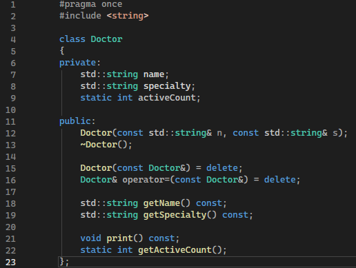

**Рисунок 2: Код файла Doctor.cpp**

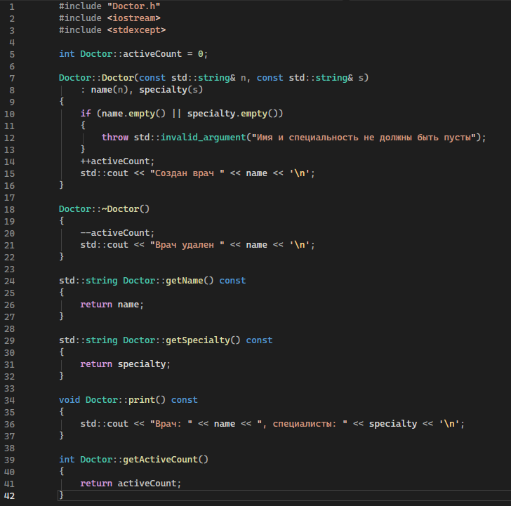

### 3.3. Класс Patient - сведения о пациентах

Класс `Patient` хранит имя и возраст пациента. Конструктор запрещает пустое имя, а метод `setAge()` проверяет, что возраст неотрицательный. Предусмотрены геттеры, метод `print()` и деструктор, выводящий сообщение об уничтожении объекта. Копирование объектов запрещено.

**Рисунок 3: Код файла Patient.h**

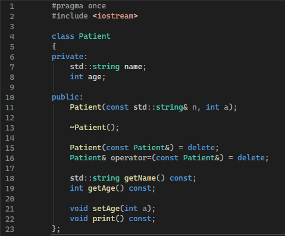

**Рисунок 4: Код файла Patient.cpp**

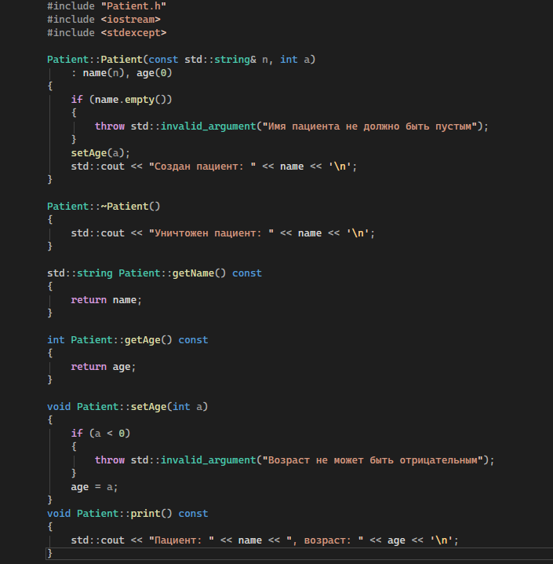

### 3.4. Класс Appointment - запись на приём

Класс `Appointment` содержит указатель на врача (`Doctor*`), указатель на пациента (`Patient*`) и строку с датой и временем приёма. При создании проверяются наличие врача и пациента, а также непустая дата. Метод `print()` выводит сведения о записи с использованием геттеров связанных объектов. При уничтожении записи врач и пациент не удаляются, поскольку запись не владеет этими объектами.

**Рисунок 5: Код файла Appointment.h**

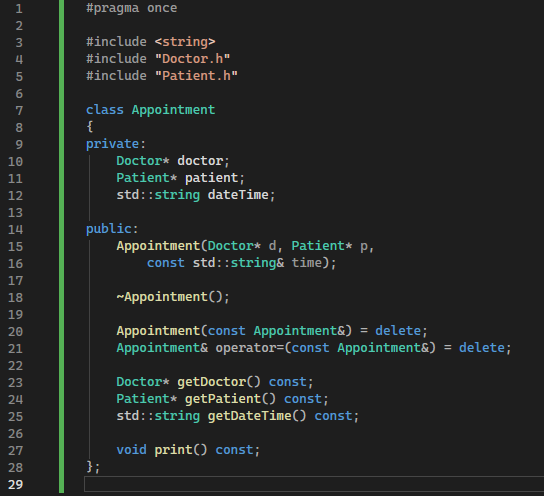

**Рисунок 6: Код файла Appointment.cpp**

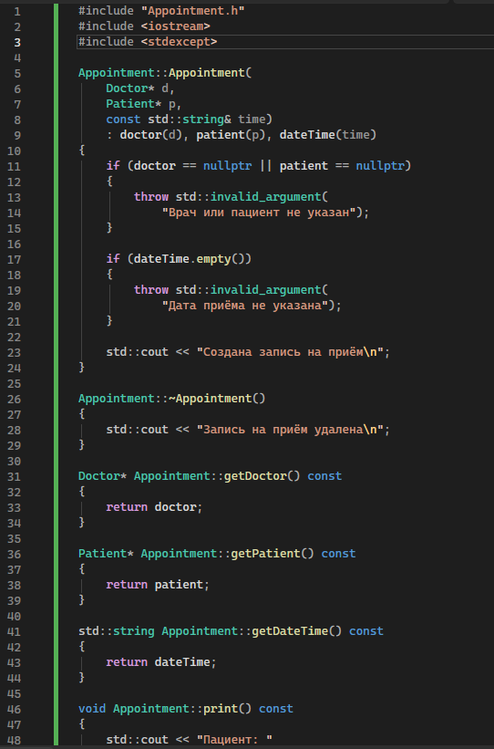

**Рисунок 7: Код файла Appointment.cpp**

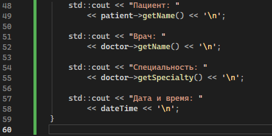

### 3.5. Класс Hospital - Singleton, композиция и агрегация

Класс `Hospital` является центральным классом системы. В нём предусмотрены следующие коллекции:

- `std::vector<Doctor*> doctors` - указатели на врачей (агрегация);
- `std::vector<Patient*> patients` - указатели на пациентов (агрегация);
- `std::vector<std::unique_ptr<Appointment>> appointments` - принадлежащие больнице записи на приём (композиция).

Метод `getInstance()` возвращает ссылку на единственный экземпляр больницы. Методы `addDoctor()` и `addPatient()` проверяют указатели на `nullptr` и запрещают повторную регистрацию одного и того же объекта. `createAppointment()` проверяет регистрацию врача и пациента, после чего создаёт запись с помощью `std::make_unique<Appointment>()`. Метод `print()` выводит содержимое коллекций.

Метод `clear()` сначала уничтожает записи на приём, а затем очищает списки указателей на врачей и пациентов. Последние при этом не уничтожаются. Порядок очистки выбран так, чтобы записи не ссылались на объекты, выведенные из списка больницы.

**Рисунок 8: Код файла Hospital.h**

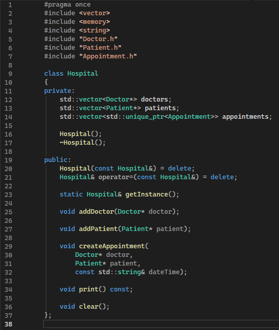

**Рисунок 9: Код файла Hospital.cpp (ч.2)**

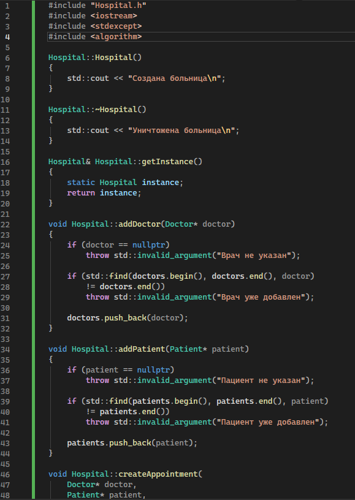 

**Рисунок 10: Код файла Hospital.cpp (ч.2)**

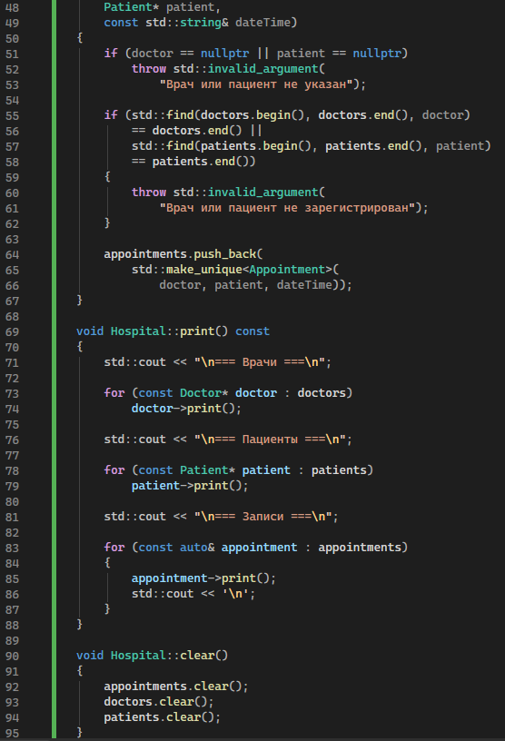

### 3.6. Демонстрационная программа main.cpp

В функции `main()` создаются два врача и два пациента, затем получается экземпляр больницы через `Hospital::getInstance()`. Повторный вызов этого метода используется для проверки Singleton: адреса обеих ссылок совпадают.

После регистрации врачей и пациентов создаются две записи на приём. Программа выводит сведения о больнице и значение статического счётчика врачей. Затем выполняются отдельные проверки исключений, а после очистки больницы демонстрируется, что врачи и пациенты продолжают существовать.

**Рисунок 11: Код файла main.cpp (ч.1)**

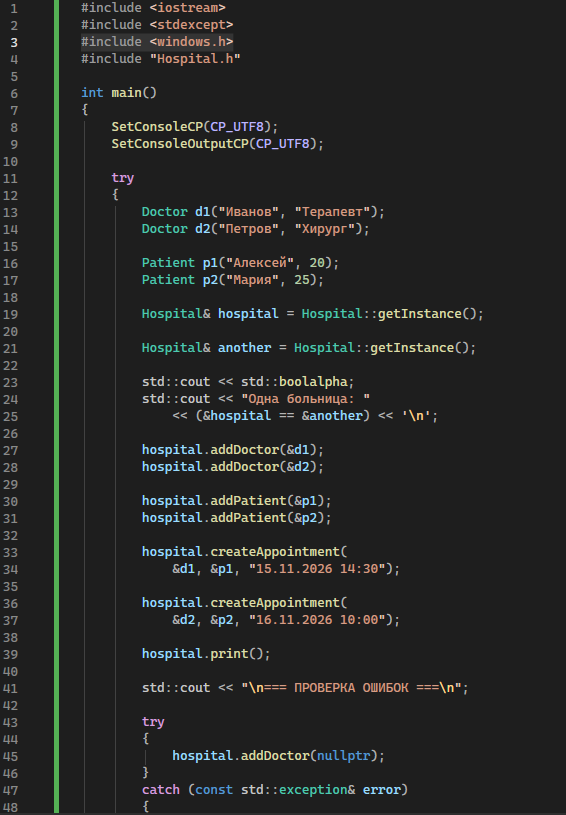

**Рисунок 12: Код файла main.cpp (ч.2)**

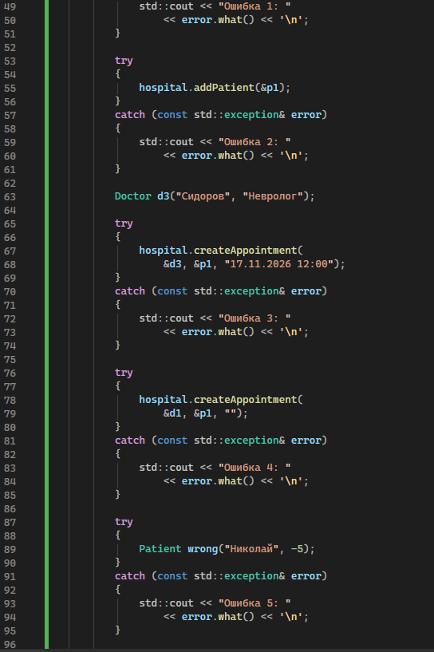

**Рисунок 13: Код файла main.cpp (ч.2)**

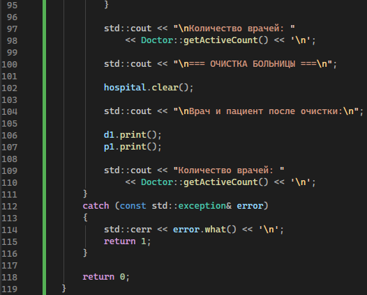

### 3.7. Проверка работы программы

В демонстрационной программе проверяются следующие ситуации:

| Проверка | Ожидаемый результат |
|---|---|
| Два вызова `Hospital::getInstance()` | Ссылки указывают на один объект (`true`) |
| Добавление двух врачей и пациентов | Объекты появляются в соответствующих списках |
| Создание записей на приём | В списке отображаются две записи |
| `hospital.addDoctor(nullptr)` | Исключение «Врач не указан» |
| Повторное `hospital.addPatient(&p1)` | Исключение «Пациент уже добавлен» |
| Запись к незарегистрированному врачу | Исключение «Врач или пациент не зарегистрирован» |
| Создание записи с пустой датой | Исключение «Дата приёма не указана» |
| Создание пациента с возрастом `-5` | Исключение «Возраст не может быть отрицательным» |
| `hospital.clear()` | Записи удаляются; врачи и пациенты остаются существовать |

**Рисунок 14: консоль, создание объектов и вывод данных больницы**

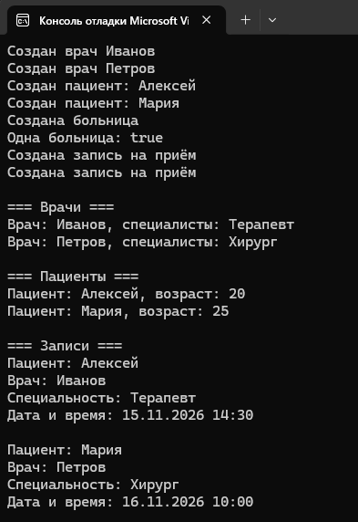

**Рисунок 15: Проверка обработки исключений, очистка больницы и независимое существование врача и пациента**

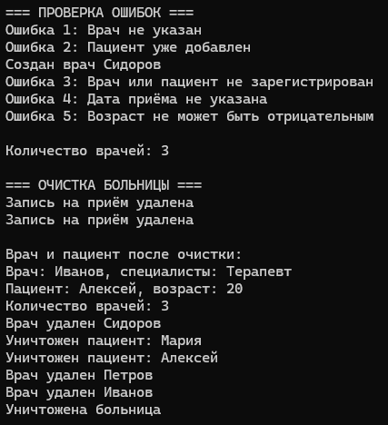

## 4. Анализ результатов

Реализованная система иллюстрирует различные способы взаимодействия объектов. Больница обращается к врачам и пациентам через указатели, не принимая владение ими. Поэтому при `hospital.clear()` очищаются списки адресов, но соответствующие объекты остаются существовать. Это соответствует отношению агрегации.

Записи на приём создаются больницей и хранятся в коллекции `std::unique_ptr<Appointment>`. При вызове `appointments.clear()` память записей освобождается автоматически. Таким образом продемонстрирована композиция.

Повторное получение экземпляра `Hospital` позволяет проверить реализацию Singleton. Статическое поле `Doctor::activeCount` позволяет отслеживать количество существующих врачей: после создания двух зарегистрированных врачей и одного дополнительного незарегистрированного врача счётчик равен трём. После очистки больницы его значение не уменьшается, поскольку врачи продолжают существовать.

Обработка ошибок предусмотрена для пустых указателей, повторного добавления объектов, незарегистрированных участников приёма, пустой даты и отрицательного возраста. Отдельные блоки `try`/`catch` позволяют проверить несколько ошибочных ситуаций за один запуск, не прерывая дальнейшие испытания программы.

**Ограничения реализации:** дата приёма хранится строкой и проверяется только на пустоту; корректность календарной даты и времени не проверяется. Также больница хранит невладеющие указатели на врачей и пациентов, поэтому их время жизни должно превышать период использования этих указателей. В `main()` очистка больницы выполняется до уничтожения локальных объектов врачей и пациентов.

## 5. Ответы на контрольные вопросы

**1. Что такое композиция? Приведите пример.**  
Композиция - отношение «часть-целое», при котором целое владеет составными объектами и управляет их временем жизни. В программе `Hospital` владеет записями `Appointment`: после очистки списка записей они уничтожаются.

**2. Что такое агрегация? Чем она отличается от композиции?**  
Агрегация - отношение, при котором один объект связан с другими, но не управляет их жизненным циклом. В отличие от композиции, объекты-части могут существовать независимо. Так, врачи и пациенты существуют отдельно от больницы.

**3. Как реализовать композицию в C++? Приведите пример кода.**  
Композицию можно реализовать полем-объектом или владеющим умным указателем. В нашей работе используется коллекция `std::vector<std::unique_ptr<Appointment>> appointments;`: записи принадлежат объекту больницы и автоматически удаляются при очистке коллекции.

**4. Как реализовать агрегацию в C++? Приведите пример кода.**  
Агрегацию можно реализовать с помощью ссылок или невладеющих указателей. Например, `std::vector<Doctor*> doctors;` хранит адреса врачей, созданных вне больницы. Удаление указателя из списка не уничтожает врача.

**5. В чём разница между временем жизни частей при композиции и агрегации?**  
При композиции время жизни частей контролируется объектом-владельцем. При агрегации объекты существуют независимо от использующего их объекта. В нашей системе записи уничтожаются при очистке больницы, а врачи и пациенты сохраняются.

**6. Что такое статическое поле класса? Чем оно отличается от обычного поля?**  
Статическое поле является общим для всех объектов класса и существует в одном экземпляре. Обычное поле принадлежит отдельному объекту. Поле `Doctor::activeCount` хранит общее количество существующих объектов `Doctor`.

**7. Как объявить и определить статическое поле? Где оно хранится?**  
Внутри класса поле объявляют, например, как `static int activeCount;`. В используемой реализации вне класса оно определяется строкой `int Doctor::activeCount = 0;`. Такое поле имеет статическое время хранения и не размещается отдельно в каждом объекте.

**8. Что такое статический метод? Можно ли из него обратиться к нестатическим полям?**  
Статический метод принадлежит классу и может вызываться без создания объекта, например `Doctor::getActiveCount()`. Напрямую обратиться к нестатическим полям без указания конкретного объекта он не может, поскольку не имеет указателя `this`.

**9. Для чего используются статические счётчики объектов?**  
Они позволяют отслеживать количество созданных или существующих экземпляров класса. В `Doctor` счётчик увеличивается в конструкторе и уменьшается в деструкторе, поэтому отражает число существующих врачей.

**10. Что такое паттерн «Одиночка» (Singleton)? Для чего он нужен?**  
Singleton обеспечивает единственный экземпляр класса и общую точку доступа к нему. Для `Hospital` создан закрытый конструктор и статический метод `getInstance()`, возвращающий ссылку на один и тот же объект больницы.

**11. Как запретить создание копий объекта (конструктор копирования)?**  
Для этого объявляют конструктор копирования с `= delete`, например `Hospital(const Hospital&) = delete;`. Аналогично можно запретить копирующее присваивание: `Hospital& operator=(const Hospital&) = delete;`.

**12. В каком порядке вызываются конструкторы и деструкторы при композиции?**  
Сначала создаются поля-объекты, а затем выполняется тело конструктора объекта-владельца. При уничтожении сначала выполняется тело деструктора владельца, после чего уничтожаются его поля в порядке, обратном их объявлению. Для коллекции записей уничтожение её элементов обеспечивается механизмом `std::vector` и `std::unique_ptr`.

**13. Можно ли изменить статическое поле из обычного метода?**  
Да. Обычный метод класса может обращаться к статическому полю, если это позволяет уровень доступа. В нашем коде счётчик `activeCount` изменяется конструкторами и деструктором класса `Doctor`.

**14. Почему статические поля нужно определять вне класса?**  
Обычное нестандартно-инициализированное статическое поле, объявленное в классе, требует отдельного определения для выделения памяти под него. Поэтому в работе используется `int Doctor::activeCount = 0;`. Начиная с C++17 также возможно определять такие поля внутри класса с помощью `inline static`.

**15. В каких случаях стоит использовать композицию, а в каких - агрегацию?**  
Композиция подходит, когда один объект владеет другим и должен управлять его уничтожением. Агрегация используется, когда объекты самостоятельны и только связаны друг с другом. В системе больницы для записей на приём выбрана композиция, а для врачей и пациентов - агрегация.

## 6. Вывод

В ходе лабораторной работы изучены и применены композиция, агрегация, статические поля и методы, а также паттерн Singleton. Разработана система управления больницей на C++, в которой реализованы независимые объекты врачей и пациентов, принадлежащие больнице записи на приём и единый экземпляр класса `Hospital`. Дополнительно предусмотрены проверки некорректных данных и обработка исключений. Работа позволила закрепить навыки проектирования взаимодействующих классов и управления временем жизни объектов.