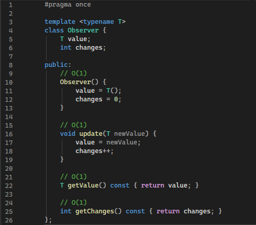
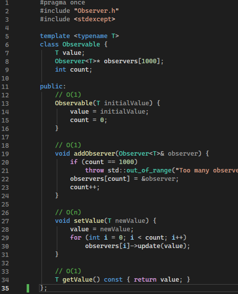
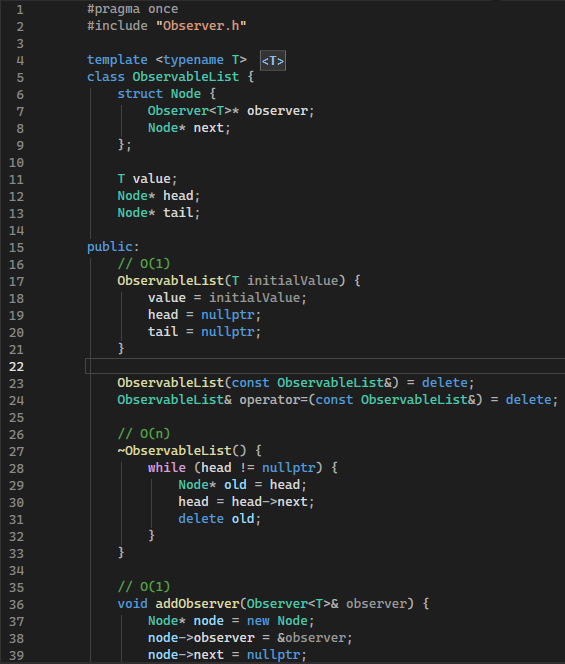
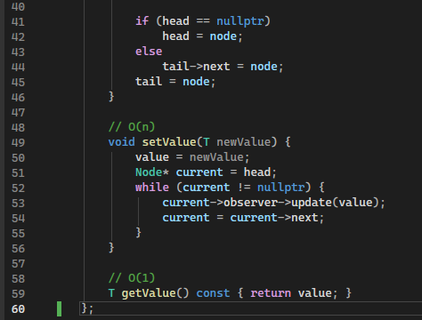
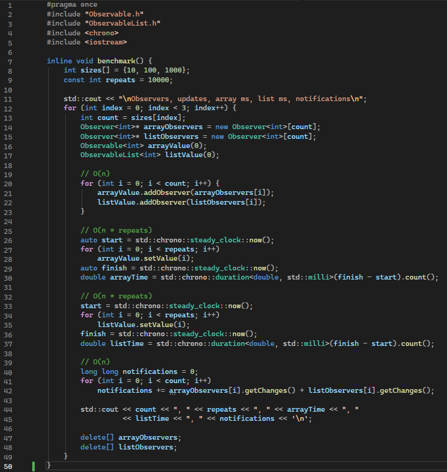
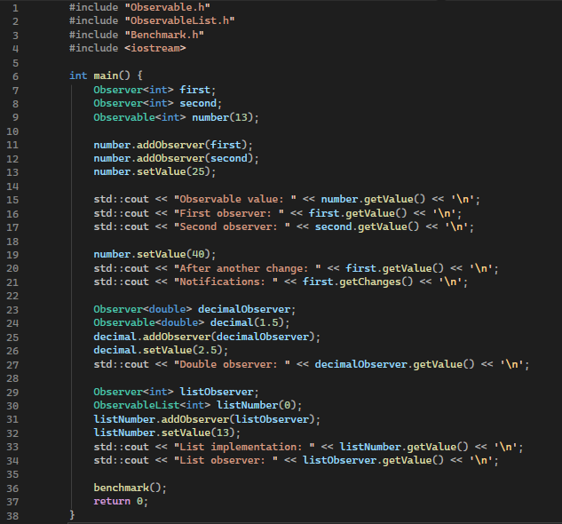
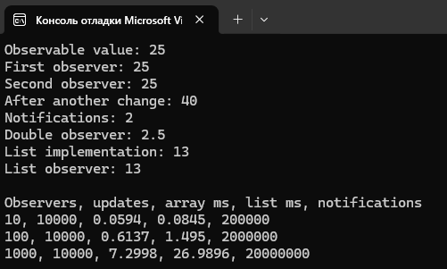

# Отчёт по лабораторной работе № 2: «Анализ сложности алгоритмов. Шаблоны классов»

**Дисциплина:** «Алгоритмы и структуры данных»

**Студент:** Сусло Антон

**Группа:** ПИЖ-б-о-25-2 (2)

**Вариант:** 13

**Ссылка на Git-репозиторий:** https://github.com/Sobo33/algo_2nd_year

## 1. Тема и цель работы

**Тема работы:** «Анализ сложности алгоритмов. Шаблоны классов».

**Цель работы:** реализовать шаблонный класс Observable, изучить передачу нового значения подписчикам, определить сложность операций и сравнить два способа хранения подписчиков.

## 2. Краткое теоретическое обоснование

**Шаблон класса** позволяет использовать один и тот же код для разных типов данных. В работе параметр `T` обозначает тип наблюдаемого значения.

**Наблюдаемый объект** хранит значение и сообщает о каждом вызове `setValue` зарегистрированным наблюдателям. Наблюдатель получает новое значение через метод `update`.

**Массив и список** позволяют хранить адреса наблюдателей по-разному. В массиве адреса расположены подряд, а в списке каждый узел содержит адрес наблюдателя и ссылку на следующий узел.

**О-нотация** описывает рост числа действий алгоритма. O(1) означает постоянное число действий, O(n) - линейную зависимость от количества элементов.

## 3. Методика выполнения лабораторной работы

### 3.1. Постановка индивидуального задания

**Вариант 13, средний уровень:** реализовать шаблонный класс `Observable<T>` с методами `setValue`, `getValue` и `addObserver`. Для каждой операции указать сложность. Сравнить две реализации хранения подписчиков: массив и односвязный список. Продемонстрировать работу с типами `int` и `double`.

### 3.2. Класс Observer - получение уведомлений

Сначала создан простой класс `Observer<T>`. Он хранит последнее полученное значение и число уведомлений. Метод `update` записывает значение и увеличивает счётчик. Методы `getValue` и `getChanges` нужны для вывода результата.

Такой наблюдатель позволяет увидеть, что объект действительно получил уведомление, а не только изменил собственное значение.

**Рисунок 1: Код файла Observer.h**

### 3.3. Класс Observable - массив подписчиков

Класс `Observable<T>` хранит значение, массив адресов наблюдателей и число занятых ячеек. Метод `addObserver` записывает адрес нового наблюдателя в конец массива. Вместимость этой реализации составляет 1000 подписчиков; при её превышении создаётся исключение.

Метод `setValue` сохраняет новое значение и вызывает `update` для каждого подписчика. Метод `getValue` возвращает текущее значение. При регистрации уведомление не отправляется; каждый последующий вызов `setValue` уведомляет всех подписчиков.

**Рисунок 2: Код файла Observable.h**

### 3.4. Класс ObservableList - список подписчиков

Во второй реализации адреса наблюдателей хранятся в односвязных узлах. Указатели `head` и `tail` обозначают первый и последний узлы. Метод `addObserver` добавляет узел в конец, а `setValue` проходит по цепочке и вызывает `update`.

Деструктор удаляет узлы списка. Сами наблюдатели создаются отдельно и не удаляются наблюдаемым объектом. Они должны существовать во время отправки уведомлений. Копирование списка запрещено, чтобы два объекта не освобождали одни узлы.

**Рисунок 3: Код файла ObservableList.h (ч.1)**

**Рисунок 4: Код файла ObservableList.h (ч.2)**

### 3.5. Сравнение двух реализаций

В файле `Benchmark.h` для каждого способа хранения создаётся одинаковое число наблюдателей: 10, 100 и 1000. Затем выполняется по 10000 вызовов `setValue`. Каждый наблюдатель сохраняет новое значение и увеличивает свой счётчик.

Время измеряется через `std::chrono::steady_clock`. Создание объектов и регистрация подписчиков выполняются до начала замера. В конце выводится сумма уведомлений двух реализаций, после чего временные массивы наблюдателей удаляются.

**Рисунок 5: Код файла Benchmark.h**

### 3.6. Демонстрационная программа var_13.cpp

В функции `main()` к целочисленному объекту подключаются два наблюдателя. Значение меняется сначала на 25, затем на 40. На экран выводятся полученные значения и число уведомлений.

После этого показана работа с `double` и реализация на списке. В конце запускается сравнение времени выполнения двух реализаций.

**Рисунок 6: Код файла var_13.cpp**

### 3.7. Проверка работы программы

В демонстрационной программе проверяются следующие ситуации:

| Проверка | Ожидаемый результат |
|---|---|
| Установить 25 при двух подписчиках | Объект и оба наблюдателя содержат 25 |
| Установить 40 | Наблюдатель содержит 40, число уведомлений равно 2 |
| Передать наблюдателю значение типа double | 2.5 |
| Установить 13 в реализации на списке | Объект и наблюдатель содержат 13 |
| Выполнить 10000 обновлений для n подписчиков в обеих реализациях | Всего 2 * n * 10000 уведомлений |

**Рисунок 7: Результат работы программы**

В данном запуске массив подписчиков оказался быстрее списка. В обоих случаях время растёт с числом подписчиков, что соответствует O(n) на одно обновление. Значения могут меняться при повторном запуске.

## 4. Анализ результатов

Пусть n - число зарегистрированных наблюдателей. Для используемых числовых типов получены следующие оценки.

| Операция | Массив подписчиков | Список подписчиков |
|---|---|---|
| Конструктор | O(1) | O(1) |
| `addObserver` | O(1) | O(1) |
| `getValue` | O(1) | O(1) |
| `setValue` | O(n) | O(n) |
| Удаление структуры подписок | O(1), фиксированный массив адресов | O(n), удаление всех узлов |

Метод `Observer::update` и чтение его полей занимают O(1). Массив всегда содержит место для 1000 адресов, а список использует O(n) узлов. Оба способа передают одинаковое число уведомлений, но последовательный проход по массиву адресов обычно требует меньше действий, чем переходы между узлами.

## 5. Ответы на контрольные вопросы

**1. Что такое О-нотация (Big O) и зачем она нужна?**  
O-нотация задаёт асимптотическую верхнюю границу затрат. Она позволяет сравнивать рост времени или памяти без привязки к конкретному компьютеру.

**2. Какая сложность у доступа к элементу массива по индексу? Почему?**  
O(1): адрес определяется началом массива, индексом и размером элемента. Постоянная проверка границ не меняет порядок сложности.

**3. Какая сложность у бинарного поиска? Почему?**  
O(log n), поскольку область поиска на каждом шаге уменьшается примерно вдвое. Нужны упорядоченные данные и быстрый доступ к середине.

**4. Что означает сложность O(n log n)? Приведите пример алгоритма.**  
Затраты растут как произведение n и логарифма n. Примеры - сортировка слиянием и пирамидальная сортировка.

**5. Что такое амортизированный анализ? Приведите пример.**  
Стоимость дорогих операций распределяется по последовательности вызовов. У динамического массива с удвоением вместимости push_back имеет O(1) амортизированно, хотя отдельный рост занимает O(n).

**6. Какая сложность у двух вложенных циклов по n итераций каждый?**  
Если оба цикла имеют n итераций, а тело занимает O(1), результат O(n²). При зависимых границах нужно суммировать реальное число итераций.

**7. Какая сложность у рекурсивного вычисления чисел Фибоначчи?**  
Прямая рекурсия повторно решает одинаковые подзадачи и имеет экспоненциальное время Θ(φⁿ); O(2ⁿ) - распространённая более грубая верхняя оценка. Глубина стека O(n).

**8. Что такое шаблоны функций? Как их объявить и использовать?**  
Шаблон функции задаёт общий алгоритм для разных типов. Объявление начинается с `template<class T>`, после чего T используется как тип параметров и результата. При вызове компилятор определяет T по переданным значениям.

**9. Что такое шаблоны классов? Как их объявить и использовать?**  
Шаблон класса задаёт общую структуру для разных типов. Например, в `Observable<T>` параметр T обозначает тип значения, а `Observable<int>` создаёт вариант класса для целых чисел.

**10. В чём преимущество шаблонов перед перегрузкой функций?**  
Шаблоны уменьшают повторение одинакового кода и проверяются при компиляции. Перегрузки удобны, когда логика для типов различается.

**11. Как указать, что шаблонный параметр - тип?**  
Параметр типа объявляют через `typename T` или `class T`. В списке параметров шаблона эти формы равнозначны.

**12. Можно ли создать шаблон с несколькими параметрами типов?**  
Да. Например, класс может иметь параметры Key и Value. Кроме типов параметрами шаблона могут быть постоянные значения, известные при компиляции.

**13. Как провести экспериментальное измерение времени выполнения?**  
Подготовить одинаковые данные, взять отметки std::chrono::steady_clock до и после нужного участка и использовать вычисленный результат. Подготовку и вывод лучше исключить из измерения.

**14. Почему при измерении времени нужно выполнять операцию многократно?**  
Повторение увеличивает измеряемый интервал относительно погрешности таймера. Разделив общее время на число повторений, получаем среднее время операции или цикла.

**15. Что важнее: сложность алгоритма или константа?**  
На больших входах обычно определяет результат порядок роста. На малых данных существенны константы, кэш, компилятор и стоимость выделения памяти.

## 6. Вывод

Реализован Observable с тремя требуемыми методами и простым наблюдателем. Проверены уведомления для целых и вещественных значений. Сравнены хранение подписчиков в массиве и в списке, определена сложность операций и разобраны типовые циклы из методички.
