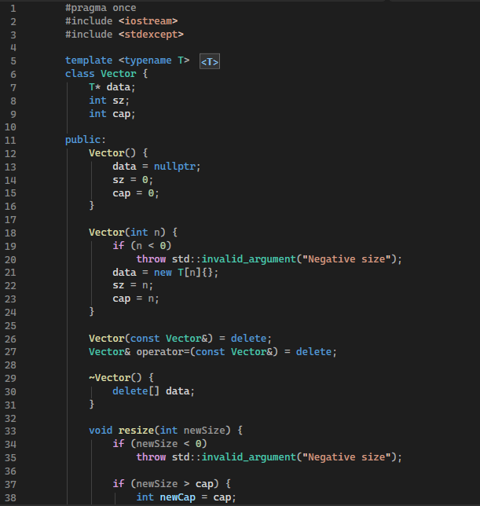
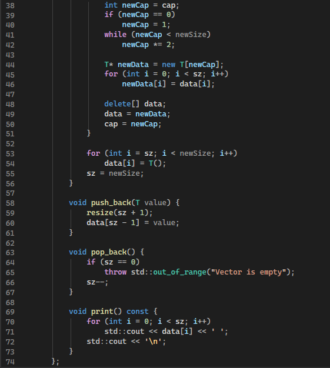
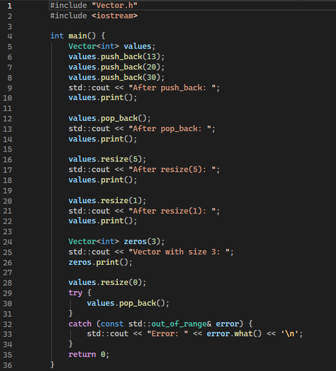
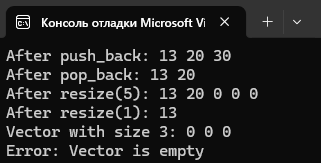

# Отчёт по лабораторной работе № 3: «Реализация динамического массива (аналог vector). Итераторы»

**Дисциплина:** «Алгоритмы и структуры данных»

**Студент:** Сусло Антон

**Группа:** ПИЖ-б-о-25-2 (2)

**Вариант:** 13

**Ссылка на Git-репозиторий:** https://github.com/Sobo33/algo_2nd_year

## 1. Тема и цель работы

**Тема работы:** «Реализация динамического массива (аналог vector). Итераторы».

**Цель работы:** реализовать базовый шаблонный динамический массив, освоить выделение и освобождение памяти, добавление и удаление элементов, изменение размера и вывод.

## 2. Краткое теоретическое обоснование

**Динамический массив** хранит элементы в одном буфере, размер которого может увеличиваться во время работы. При расширении создаётся новый массив, в него копируются данные, а старый массив удаляется.

**Размер и вместимость** различаются: размер показывает число используемых элементов, а вместимость - число выделенных ячеек. Свободные ячейки позволяют добавлять элементы без нового выделения памяти.

**Конструктор** задаёт начальное состояние объекта. **Деструктор** освобождает массив через `delete[]`, когда объект перестаёт существовать.

**Шаблонный класс** использует параметр `T` вместо конкретного типа элемента. В демонстрации применяется `Vector<int>`.

## 3. Методика выполнения лабораторной работы

### 3.1. Постановка индивидуального задания

**Вариант 13, базовый уровень:** реализовать класс `Vector<T>` с конструкторами по умолчанию и с размером, деструктором и методами `push_back`, `pop_back`, `resize`, `print`. Показать работу всех методов.

### 3.2. Класс Vector - поля, конструкторы и деструктор

В файле `Vector.h` создан класс с закрытыми полями `data`, `sz` и `cap`. Они хранят адрес буфера, размер и вместимость. Конструктор по умолчанию создаёт пустой массив. Конструктор с размером выделяет нужное число ячеек и задаёт начальные значения; для `int` это нули.

Деструктор освобождает буфер через `delete[]`. Копирование запрещено, чтобы два объекта не удаляли один массив. Определения шаблонных методов размещены в заголовочном файле.

Метод `resize(newSize)` проверяет размер. Если буфера не хватает, вместимость удваивается до достаточного значения, затем элементы копируются в новый массив. Новые используемые позиции заполняются значением `T()`. При уменьшении меняется только размер, а выделенная память сохраняется.

Метод `push_back` увеличивает размер на один через `resize` и записывает значение в последнюю позицию. Метод `pop_back` уменьшает размер, предварительно проверив пустоту. Метод `print` выводит используемые элементы обычным циклом.

**Рисунок 1: Код файла Vector.h: поля и конструкторы (ч.1)**

**Рисунок 2: Код файла Vector.h: поля и конструкторы (ч.2)**

### 3.3. Демонстрационная программа var_13.cpp

В функции `main()` создаётся пустой массив и добавляются значения 13, 20 и 30. Затем удаляется последний элемент, размер увеличивается до 5 и уменьшается до 1. После каждого действия выводится содержимое.

Отдельно создаётся массив размера 3. В конце первый массив становится пустым через `resize(0)`, после чего показана обработка попытки удалить элемент из пустого контейнера.

**Рисунок 3: Код файла var_13.cpp**

### 3.4. Проверка работы программы

В демонстрационной программе проверяются следующие ситуации:

| Проверка | Ожидаемый результат |
|---|---|
| Добавить 13, 20 и 30 | `13 20 30` |
| Удалить последний элемент | `13 20` |
| Увеличить размер до 5 | `13 20 0 0 0` |
| Уменьшить размер до 1 | `13` |
| Создать массив размера 3 | `0 0 0` |
| Удалить элемент после resize(0) | Сообщение `Vector is empty` |

**Рисунок 4: Результат работы программы**

## 4. Анализ результатов

Добавление, удаление и изменение размера дают ожидаемые последовательности. При увеличении появляются нули, а при уменьшении сохраняется начало массива. Использованные данные хранятся в собственном буфере, который освобождается деструктором.

| Операция | Время |
|---|---|
| Конструктор по умолчанию | O(1) |
| Конструктор с размером n | O(n) |
| `push_back` | O(1) амортизированно, O(n) при расширении |
| `pop_back` | O(1) |
| `resize(m)` при уменьшении | O(1) |
| `resize(m)` при увеличении без расширения | O(m - n) |
| `resize(m)` с расширением | O(n + m) |
| `print` | O(n) |

Здесь n - текущий размер, m - запрошенный размер. Память составляет O(cap). При удвоении вместимости суммарное число копирований для n добавлений в изначально пустой контейнер ограничено геометрической суммой, поэтому амортизированная стоимость `push_back` постоянна.

Для числовых типов операции с отдельными элементами считаются постоянными. Для типов с нетривиальными деструкторами удаление буфера дополнительно уничтожает все cap объектов. Уменьшение размера и `pop_back` сами объекты в буфере не уничтожают.

## 5. Ответы на контрольные вопросы

**1. Почему динамический массив называется «динамическим»?**  
Размер может меняться во время выполнения. При нехватке резерва контейнер выделяет новый буфер и переносит элементы.

**2. Что такое ёмкость (capacity ) и чем она отличается от размера (size)?**  
size - число используемых элементов, capacity - число выделенных ячеек. В реализации им соответствуют поля sz и cap. Всегда sz <= cap.

**3. Почему при расширении массива ёмкость удваивается, а не увеличивается на фиксированное число?**  
Удвоение даёт геометрическую сумму переносов и O(1) амортизированно на добавление. Рост на фиксированное число может привести к O(n²) переносов за n добавлений.

**4. Какова амортизированная сложность операции push_back? Почему?**  
O(1) амортизированно. Отдельное расширение требует O(n), но оно происходит не при каждом добавлении.

**5. Что такое «правило трёх»? Когда оно применяется?**  
Правило трёх связывает деструктор, конструктор копирования и копирующее присваивание у класса, владеющего ресурсом. В базовом варианте реализован деструктор, а копирование запрещено.

**6. Что такое «правило пяти»? Чем оно отличается от «правила трёх»?**  
Правило пяти добавляет конструктор перемещения и перемещающее присваивание для передачи владения без глубокого копирования.

**7. В чём разница между конструктором копирования и оператором присваивания?**  
Конструктор создаёт новый объект. Присваивание изменяет уже существующий объект и должно правильно обработать его прежние ресурсы.

**8. Зачем нужна проверка if (this != &other) в операторе присваивания?**  
При реализации присваивания такая проверка защищает от работы объекта с самим собой. В базовом варианте оператор копирования запрещён, поэтому эта проверка не используется.

**9. Что такое итератор? Как он связан с указателем?**  
Итератор позволяет обращаться к элементу диапазона и переходить к следующему. Указатель может быть итератором непрерывного массива. В базовом варианте обход для вывода выполнен внутри print.

**10. Зачем нужны методы begin() и end()?**  
begin указывает на начало диапазона, end - на позицию после последнего элемента. Разыменовывать end нельзя. Эти методы не входят в реализованный базовый вариант 13.

**11. Как реализовать range-based for для своего контейнера?**  
Для range-based for нужны begin/end и операции разыменования, сравнения и продвижения итератора. В данной работе используется обычный цикл с индексом внутри print.

**12. Что такое «глубокое копирование»? Чем оно отличается от «поверхностного»?**  
Глубокая копия создаёт независимый буфер. Поверхностная копирует только адрес и для владельца памяти опасна общими изменениями и двойным освобождением.

**13. Что такое семантика перемещения и зачем она нужна?**  
Перемещение передаёт владение ресурсом получателю. Оно избавляет от копирования каждого элемента большого контейнера.

**14. Почему конструктор перемещения помечается noexcept?**  
noexcept сообщает, что операция не выбрасывает исключений. Это позволяет стандартным контейнерам выбирать перемещение вместо копирования в подходящих случаях. В базовой версии конструктор перемещения не реализуется.

**15. Как правильно освобождать память в деструкторе?**  
Массив, выделенный через new T[], освобождается через delete[]. Этот вызов находится в деструкторе Vector.

## 6. Вывод

Выполнен базовый вариант 13: реализованы два конструктора, деструктор и четыре требуемых метода динамического массива. Демонстрация показывает изменение содержимого и обработку пустого контейнера. Получены оценки сложности операций.
