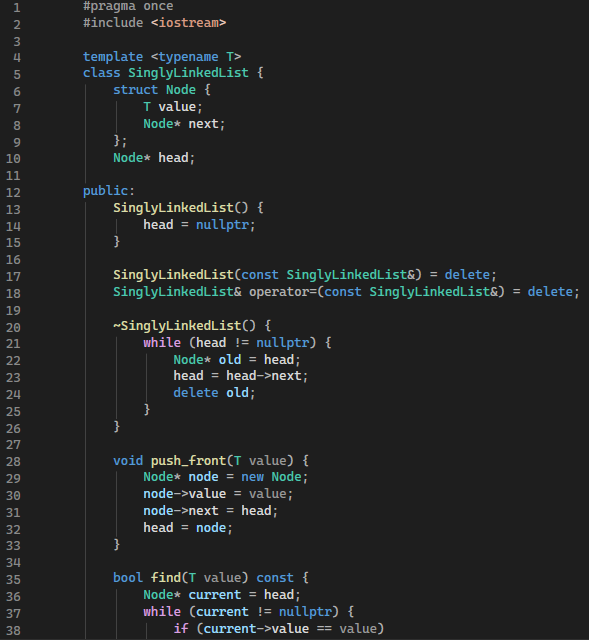
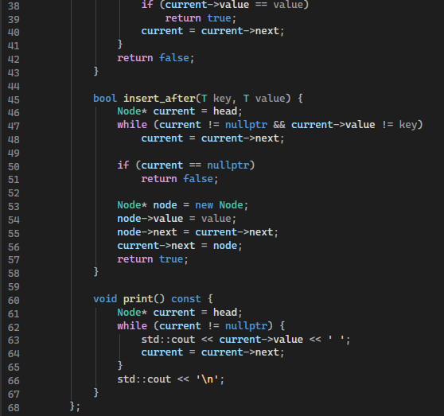
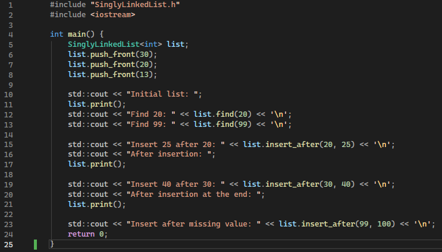
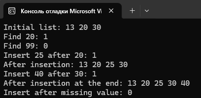

# Отчёт по лабораторной работе № 4: «Односвязный и двусвязный списки»

**Дисциплина:** «Алгоритмы и структуры данных»

**Студент:** Сусло Антон

**Группа:** ПИЖ-б-о-25-2 (2)

**Вариант:** 13

**Ссылка на Git-репозиторий:** https://github.com/Sobo33/algo_2nd_year

## 1. Тема и цель работы

**Тема работы:** «Односвязный и двусвязный списки».

**Цель работы:** реализовать шаблонный односвязный список с добавлением в начало, поиском и вставкой после заданного значения; освоить работу с узлами и освобождение памяти.

## 2. Краткое теоретическое обоснование

**Односвязный список** состоит из отдельных узлов. Каждый узел содержит значение и указатель на следующий узел. Адрес первого узла хранится в поле `head`.

**Добавление в начало** выполняется изменением двух указателей: новый узел ссылается на прежнюю голову, а `head` начинает указывать на новый узел.

**Поиск** требует последовательного обхода цепочки. Для вставки после найденного узла новый узел включается между ним и его прежним следующим узлом.

**Освобождение памяти** выполняется в деструкторе. Перед удалением очередного узла нужно сохранить переход к следующему.

## 3. Методика выполнения лабораторной работы

### 3.1. Постановка индивидуального задания

**Вариант 13, базовый уровень:** реализовать односвязный список с методами `push_front`, `find` и `insert_after`. Выполнить вставку элемента после заданного значения. Добавить вывод для демонстрации и деструктор для освобождения узлов.

### 3.2. Класс SinglyLinkedList - узлы и время жизни

В файле `SinglyLinkedList.h` объявлена структура `Node` с полями `value` и `next`. Сам список хранит только указатель `head`. Конструктор присваивает ему `nullptr`, то есть создаёт пустой список.

Деструктор проходит по цепочке и удаляет каждый узел. Копирование запрещено, чтобы два объекта не владели одними узлами.

Метод `push_front` создаёт узел, соединяет его с прежним первым узлом и обновляет `head`. Метод `find` проходит по списку и возвращает `true` при совпадении, иначе `false`.

Метод `insert_after(key, value)` находит первый узел со значением key. Новый узел сначала связывается со следующим, затем найденный узел связывается с новым. Если ключ отсутствует, возвращается `false`, а список не меняется. Метод `print` выводит значения по порядку.

**Рисунок 1: Код файла SinglyLinkedList.h (ч.1)**

**Рисунок 2: Код файла SinglyLinkedList.h (ч.2)**

### 3.3. Демонстрационная программа var_13.cpp

В функции `main()` значения 30, 20 и 13 добавляются в начало, поэтому получается последовательность 13, 20, 30. Проверяется поиск существующего значения 20 и отсутствующего значения 99.

Затем число 25 вставляется после 20, а число 40 - после последнего элемента 30. В конце показана попытка вставки после отсутствующего ключа.

**Рисунок 3: Код файла var_13.cpp**

### 3.4. Проверка работы программы

В демонстрационной программе проверяются следующие ситуации:

| Проверка | Ожидаемый результат |
|---|---|
| Добавить в начало 30, 20, 13 | `13 20 30` |
| Найти 20 | 1 |
| Найти 99 | 0 |
| Вставить 25 после 20 | `13 20 25 30` |
| Вставить 40 после 30 | `13 20 25 30 40` |
| Вставить элемент после отсутствующего 99 | 0, список не изменяется |

**Рисунок 4: Результат работы программы**

## 4. Анализ результатов

Демонстрация подтверждает правильный порядок узлов после добавления в начало и вставки в середину и конец. Значение 1 означает успех или найденный элемент, значение 0 - отсутствие ключа.

| Операция | Время |
|---|---|
| Конструктор | O(1) |
| `push_front` | O(1) |
| `find` | O(n) |
| `insert_after` с поиском ключа | O(n) |
| `print` | O(n) |
| Деструктор | O(n) |

Память составляет O(n), где n - число узлов. После нахождения нужного узла сама вставка выполняется за O(1), поскольку меняются только две связи. Линейная оценка `insert_after` учитывает поиск ключа.

## 5. Ответы на контрольные вопросы

**1. Чем связный список отличается от динамического массива?**  
Массив хранит элементы непрерывно и позволяет доступ по индексу за O(1). Список хранит отдельные узлы со ссылками; доступ по индексу требует обхода, но локальные вставки не сдвигают массив.

**2. Какие операции в односвязном списке выполняются за O(1)?**  
Добавление и удаление головы, получение головы, а при наличии tail - добавление в конец. Вставка после уже известного узла также O(1); поиск этого узла считается отдельно.

**3. Почему удаление из конца односвязного списка требует O(n) времени?**  
Для удаления tail нужно найти его предшественника. В односвязном списке нет обратной ссылки, поэтому приходится идти от head.

**4. Какие преимущества даёт хранение указателя tail в односвязном списке?**  
tail обеспечивает добавление в конец и получение последнего значения за O(1). Удаление с конца без previous всё равно требует O(n).

**5. Чем двусвязный список отличается от односвязного?**  
Узел двусвязного списка хранит и next, и previous. Это позволяет обход в обоих направлениях ценой дополнительной памяти.

**6. Какие операции в двусвязном списке выполняются быстрее, чем в односвязном?**  
Удаление хвоста и удаление уже известного узла занимают O(1). Если узел сначала ищут по индексу или значению, стоимость поиска сохраняется.

**7. Что такое «голова» (head) и «хвост» (tail) списка?**  
head - указатель на первый узел, tail - на последний. У пустого списка оба равны nullptr.

**8. Как удалить узел из середины односвязного списка?**  
Нужно знать предыдущий узел, связать его next со следующим узлом удаляемого и освободить удаляемый. При удалении хвоста также обновляется tail.

**9. Как удалить узел из середины двусвязного списка? Почему это проще?**  
Обновляются next предыдущего и previous следующего узла, затем удаляемый освобождается. Предшественник уже известен через previous.

**10. Что произойдёт, если забыть обновить tail при удалении?**  
tail может указывать на освобождённую память или перестать обозначать конец. Последующие операции могут повредить структуру либо обратиться к недействительному адресу.

**11. Как реализовать реверс односвязного списка?**  
Идти по цепочке, сохраняя следующий узел и направляя next на предыдущий. После обхода прежняя голова становится хвостом, а последний посещённый узел - головой.

**12. Как обнаружить цикл в связном списке?**  
Использовать два указателя: медленный движется на один узел, быстрый - на два. Их встреча до достижения конца указывает на цикл.

**13. В каких случаях стоит использовать список вместо массива?**  
Когда нужны частые вставки и удаления по известным позициям-узлам и не требуется быстрый индексный доступ. Нужно учитывать затраты на выделение узлов и менее выгодную локальность памяти.

**14. Какая дополнительная память требуется для каждого узла списка?**  
Односвязный узел хранит один указатель, двусвязный - два, дополнительно к T. Фактический расход включает выравнивание и служебные расходы выделения памяти.

**15. Почему доступ по индексу в списке имеет сложность O(n)?**  
Адрес произвольного узла нельзя вычислить арифметически, как в массиве. Для индекса нужно пройти соответствующее число связей; худший случай O(n).

## 6. Вывод

Реализован базовый вариант 13 для односвязного списка: добавление в начало, поиск и вставка после заданного значения. Показаны успешные операции и обработка отсутствующего ключа. Деструктор освобождает все созданные узлы.
