# Отчёт по лабораторной работе № 5: «Стек, очередь, дек, приоритетная очередь»

**Дисциплина:** «Алгоритмы и структуры данных»

**Студент:** Сусло Антон

**Группа:** ПИЖ-б-о-25-2 (2)

**Вариант:** 13

**Ссылка на Git-репозиторий:** https://github.com/Sobo33/algo_2nd_year

## 1. Тема и цель работы

**Тема работы:** «Стек, очередь, дек, приоритетная очередь».

**Цель работы:** реализовать стек, очередь, дек и приоритетную очередь простыми средствами C++; выполнить четыре задания варианта 13 и определить сложность операций.

## 2. Краткое теоретическое обоснование

**Стек** работает по принципу LIFO: последним добавили - первым извлекли. В работе он хранится в динамическом массиве.

**Очередь** работает по принципу FIFO: первым добавили - первым извлекли. Кольцевой буфер позволяет использовать освободившиеся ячейки в начале массива.

**Дек** допускает добавление и удаление с обоих концов. Для него используется цепочка узлов со ссылками на предыдущий и следующий узлы.

**Приоритетная очередь** извлекает максимальный элемент. В двоичной куче значение родителя не меньше значений детей; максимум находится в корне.

## 3. Методика выполнения лабораторной работы

### 3.1. Постановка индивидуального задания

**Вариант 13:** реализовать стек с `reverse`, очередь с `rotate(k)`, дек с `removeAt(index)` и приоритетную очередь с `heapify` для произвольного массива, выполнены все четыре задания. Структуры работают с целыми числами.

### 3.2. Класс Stack - стек на массиве

В `Stack.h` объявлен класс, а в `Stack.cpp` определены его методы. Массив хранит элементы, поле count - размер, capacity - вместимость. При заполнении буфер удваивается, а значения копируются обычным циклом. `push` добавляет в конец, `pop` извлекает последний элемент, `top` читает его без удаления.

Метод `reverse` меняет местами первый и последний элементы, затем вторую и предпоследнюю позиции и так далее до середины. Дополнительный массив не используется.

**Рисунок 1: Код файла Stack.h**

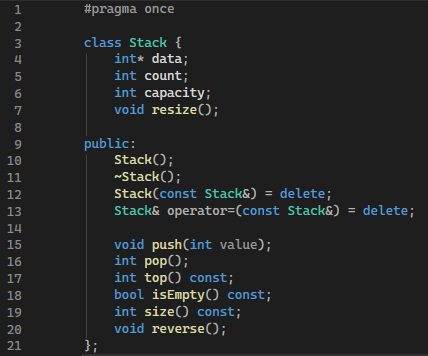

**Рисунок 2: Код файла Stack.cpp (ч.1)**

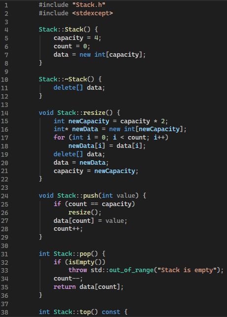

**Рисунок 3: Код файла Stack.cpp (ч.2)**

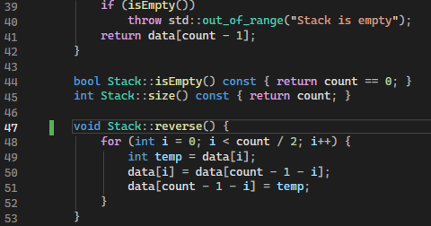

### 3.3. Класс Queue - очередь на кольцевом буфере

В `Queue.h` и `Queue.cpp` реализована очередь. Поле head хранит индекс первого элемента. Индекс для добавления вычисляется как `(head + count) % capacity`. После извлечения head сдвигается по модулю вместимости. При заполнении буфер расширяется, а элементы копируются в порядке очереди.

Метод `rotate(k)` выполняет сдвиг влево. После вычисления `k % count` первый элемент k раз извлекается и добавляется в конец. Для пустой очереди операция ничего не делает, отрицательный сдвиг вызывает исключение.

**Рисунок 4: Код файла Queue.h**

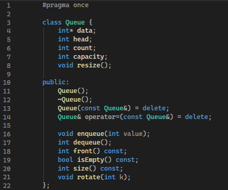

**Рисунок 5: Код файла Queue.cpp (ч.1)**

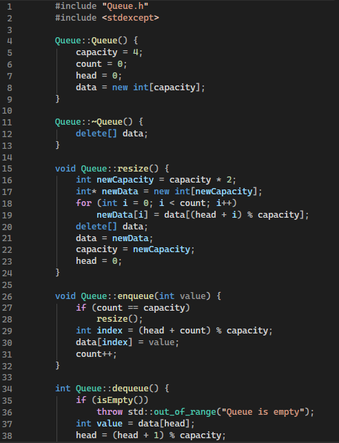

**Рисунок 6: Код файла Queue.cpp (ч.2)**

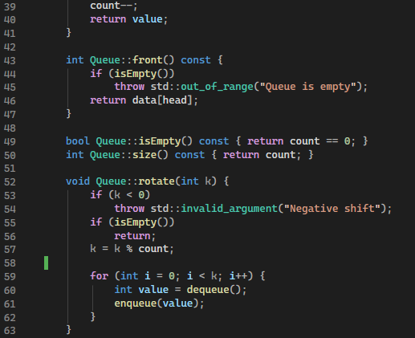

### 3.4. Класс Deque - дек на двусвязных узлах

В `Deque.h` и `Deque.cpp` реализован дек. Узел содержит целое значение и две связи. Поля head и tail указывают на крайние узлы. Операции `push_front`, `push_back`, `pop_front` и `pop_back` изменяют соответствующие связи и размер.

Метод `removeAt` использует индексацию с нуля. Для крайних элементов вызываются обычные методы удаления. В середине находится нужный узел, его соседи соединяются друг с другом, затем узел удаляется.

**Рисунок 7: Код файла Deque.h**

**Рисунок 8: Код файла Deque.cpp (ч. 1)**

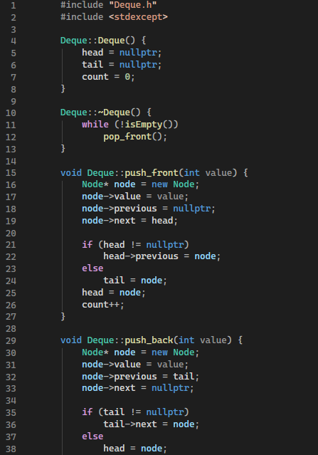

**Рисунок 9: Код файла Deque.cpp (ч. 2)**

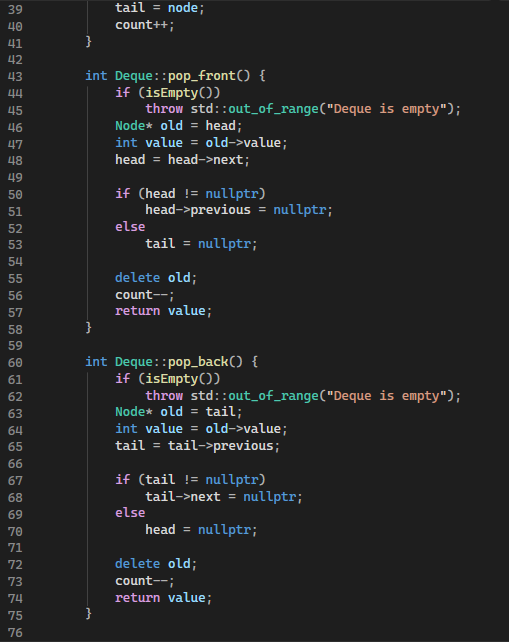

**Рисунок 10: Код файла Deque.cpp (ч. 3)**

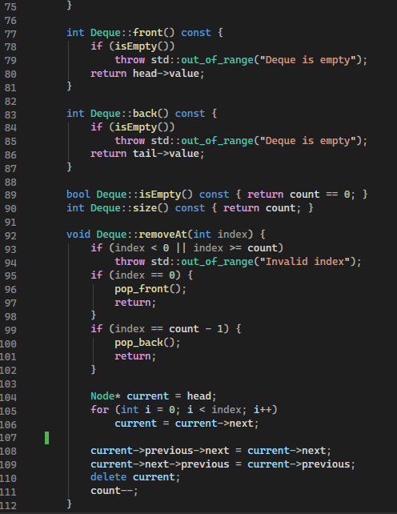

### 3.5. Класс PriorityQueue - двоичная куча

В `PriorityQueue.h` и `PriorityQueue.cpp` реализована куча в собственном динамическом массиве. Готовые контейнеры STL не используются. Для индекса i родитель имеет индекс `(i - 1) / 2`, левый ребёнок - `2 * i + 1`, правый - `2 * i + 2`.

При добавлении `heapifyUp` поднимает элемент к корню. При удалении последний элемент переносится в корень, после чего `heapifyDown` меняет его с большим ребёнком, пока порядок не восстановится.

Метод `heapify` копирует произвольный массив и просеивает внутренние узлы от последнего к корню. Вместимость увеличивается при необходимости.

**Рисунок 11: Код файла PriorityQueue.h**

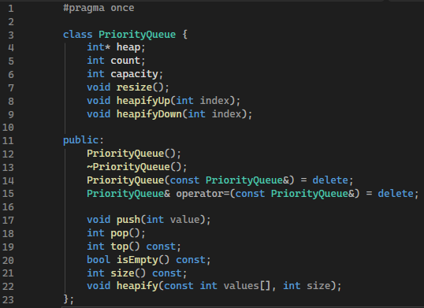

**Рисунок 12: Код файла PriorityQueue.cpp (ч. 1)**

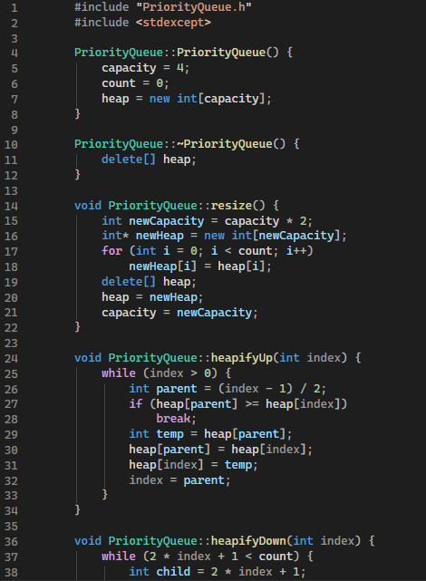

**Рисунок 13: Код файла PriorityQueue.cpp (ч. 2)**

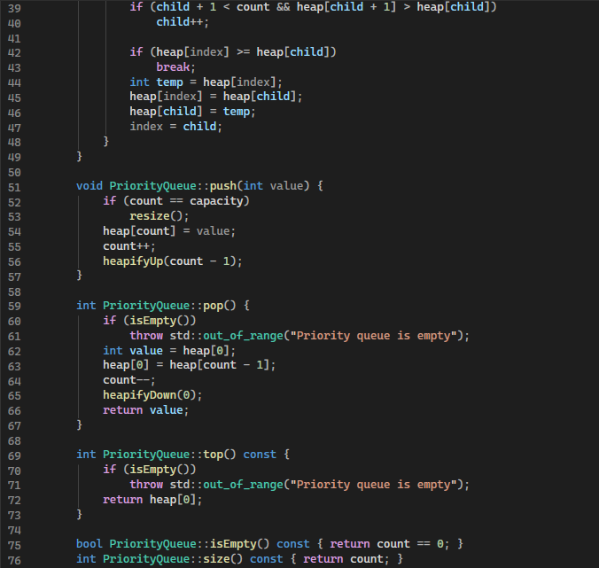

**Рисунок 14: Код файла PriorityQueue.cpp (ч. 3)**

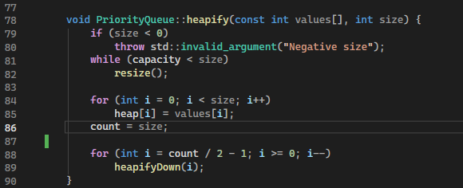

### 3.6. Демонстрационная программа var_13.cpp

В функции `main()` последовательно показываются разворот стека, сдвиг очереди, удаление из дека и построение кучи. После операций элементы извлекаются и выводятся, поэтому виден их порядок.

Для всех структур выводятся нужные значения и размеры. В конце отдельными блоками `try`/`catch` показаны попытки удаления из пустых структур. В классах предусмотрены деструкторы; копирование запрещено, чтобы один буфер или узел не освобождался двумя объектами.

**Рисунок 15: Код файла var_13.cpp (ч. 1)**

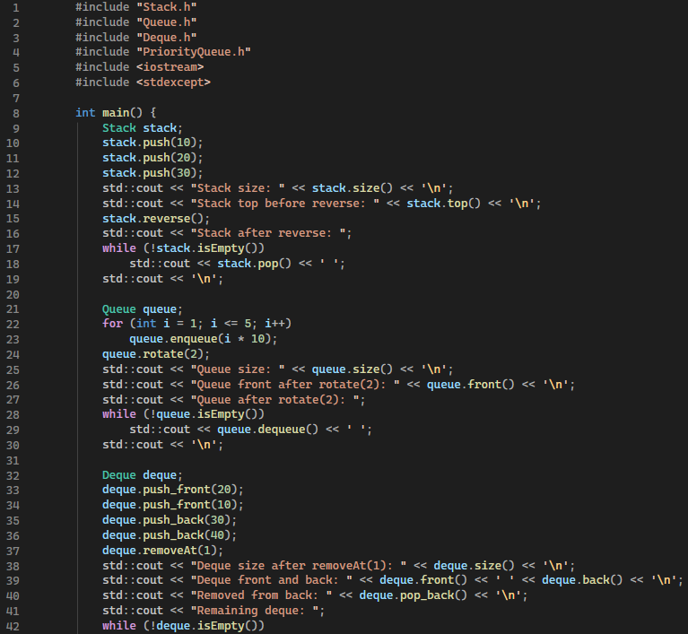

**Рисунок 16: Код файла var_13.cpp (ч. 2)**

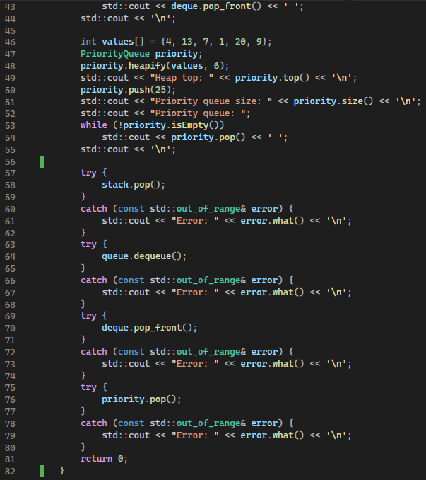

### 3.7. Проверка работы программы

В демонстрационной программе проверяются следующие ситуации:

| Проверка | Ожидаемый результат |
|---|---|
| Развернуть стек с вершиной 30 | Извлечение: `10 20 30` |
| Сдвинуть очередь `10 20 30 40 50` на 2 | `30 40 50 10 20` |
| Удалить индекс 1 из дека `10 20 30 40` | Размер 3, крайние значения 10 и 40 |
| Удалить последний элемент дека | Удаляется 40, остаются `10 30` |
| Построить кучу из `4 13 7 1 20 9` | Максимум 20 |
| Добавить 25 и извлечь очередь | `25 20 13 9 7 4 1` |
| Удалить из пустого стека | `Stack is empty` |
| Извлечь из пустой очереди | `Queue is empty` |
| Удалить из пустого дека | `Deque is empty` |
| Извлечь из пустой приоритетной очереди | `Priority queue is empty` |

**Рисунок 17: Результат работы программы**

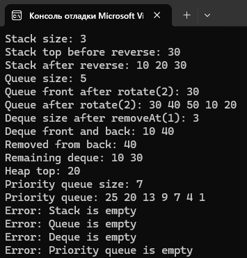

## 4. Анализ результатов

Операции варианта 13 дают ожидаемый порядок элементов. Разворот меняет порядок извлечения из стека, сдвиг переносит начало очереди в конец, удаление из дека сохраняет связи соседей, а куча выдаёт значения по убыванию.

| Структура | Операция | Время |
|---|---|---|
| Стек | `push` | O(1) амортизированно, O(n) при расширении |
| Стек | `pop`, `top` | O(1) |
| Стек | `reverse` | O(n) |
| Очередь | `enqueue` | O(1) амортизированно, O(n) при расширении |
| Очередь | `dequeue`, `front` | O(1) |
| Очередь | `rotate(k)` | O(1 + k mod n), для пустой очереди O(1) |
| Дек | Операции с концами | O(1) |
| Дек | `removeAt` | O(n), на концах O(1) |
| Приоритетная очередь | `top` | O(1) |
| Приоритетная очередь | `push` | O(log n) амортизированно, O(n) при расширении |
| Приоритетная очередь | `pop`, `heapifyUp`, `heapifyDown` | O(log n) |
| Приоритетная очередь | `heapify` | O(n) |
| Все структуры | `size`, `isEmpty` | O(1) |

Каждая структура использует O(n) памяти. Вспомогательное расширение массива требует линейного копирования. `reverse`, `rotate` и `removeAt` не создают дополнительных массивов. В `rotate` после извлечения появляется свободное место, поэтому следующее добавление не требует расширения.

Построение кучи занимает O(n), поскольку большинство узлов близки к листьям и требуют мало перестановок. Узлы дека удаляются деструктором за O(n); массивы остальных структур освобождаются через `delete[]`.

## 5. Ответы на контрольные вопросы

**1. В чём заключается принцип работы стека (LIFO)?**  
LIFO означает «последним пришёл - первым вышел». push добавляет на вершину, pop удаляет вершину, top возвращает её значение.

**2. В чём заключается принцип работы очереди (FIFO)?**  
FIFO означает «первым пришёл - первым вышел». Добавление выполняется в конец, извлечение - из начала.

**3. Чем дек отличается от обычной очереди?**  
Дек разрешает добавлять и удалять элементы с обоих концов. У обычной очереди добавление и извлечение выполняются с разных фиксированных концов.

**4. Что такое приоритетная очередь? Где она применяется?**  
Она извлекает элемент по приоритету, а не по времени добавления. Применяется в планировщиках, алгоритме Дейкстры, обработке событий и выборе экстремальных значений.

**5. Как реализовать стек на основе динамического массива?**  
Хранить элементы в массиве и число занятых мест. push записывает в конец с расширением при необходимости, pop уменьшает размер, top обращается к последнему элементу.

**6. Как реализовать очередь на основе кольцевого буфера?**  
Хранить буфер, индекс головы и число элементов. Индекс для добавления равен (head + size) % capacity; после извлечения голова сдвигается по модулю capacity.

**7. Почему приоритетную очередь обычно реализуют на куче?**  
Куча хранит экстремальный элемент в корне и имеет логарифмическую высоту. Это даёт O(1) для top и O(log n) для основных изменений.

**8. Какова сложность операций push и pop в стеке?**  
На связном списке обе операции O(1). На динамическом массиве pop - O(1), push - O(1) амортизированно, с отдельными расширениями O(n).

**9. Какова сложность операций enqueue и dequeue в очереди?**  
При хранении головы и хвоста списка enqueue и dequeue имеют O(1). В растущем кольцевом массиве добавление обычно O(1) амортизированно.

**10. Какова сложность операций в приоритетной очереди? Почему?**  
Для двоичной кучи top - O(1), удаление - O(log n), вставка - O(log n) без учёта редкого расширения массива. Построение снизу вверх - O(n).

**11. Как проверить правильность расстановки скобок с помощью стека?**  
Открывающие скобки помещать в стек. Для закрывающей проверять соответствие вершине и удалять её. В конце стек должен быть пуст; недостаток или несовпадение скобок означает ошибку.

**12. Как реализовать очередь на двух стеках? Какова сложность?**  
Новые значения класть в первый стек. Для извлечения, если второй пуст, перенести в него все значения первого: порядок развернётся. Каждое значение переносится один раз, поэтому операции O(1) амортизированно.

**13. Как реализовать дек на основе двусвязного списка?**  
Хранить head и tail; добавление и удаление крайних узлов обновляет next/previous. Все четыре операции с концами занимают O(1).

**14. Как реализовать дек на основе кольцевого буфера?**  
Хранить массив, head и size. Добавление спереди уменьшает head по модулю capacity, добавление сзади использует (head + size) % capacity. При заполнении нужно расширить буфер либо выдать ошибку.

**15. Как реализовать стек с поддержкой получения минимума за O(1)?**  
Хранить вместе с каждым значением минимум до этой позиции либо использовать дополнительный стек минимумов. Тогда текущий минимум доступен на вершине за O(1).

## 6. Вывод

Выполнены все четыре задания варианта 13. Использованы обычные динамические массивы, кольцевой буфер и двусвязные узлы. Реализованы разворот, циклический сдвиг, удаление по индексу и построение кучи. Показаны основные операции, размеры структур и обработка пустоты.
